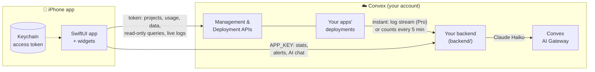
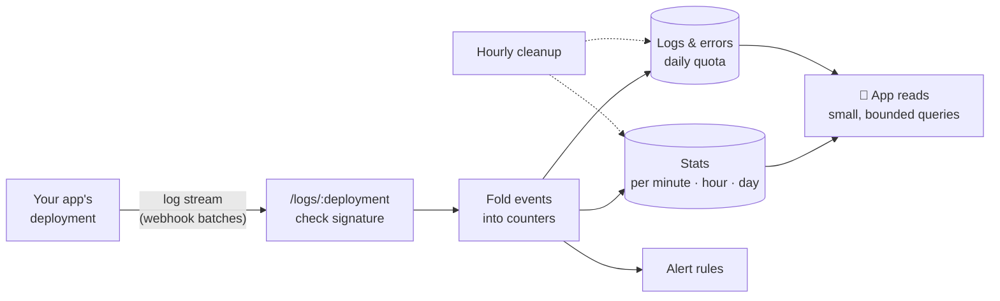
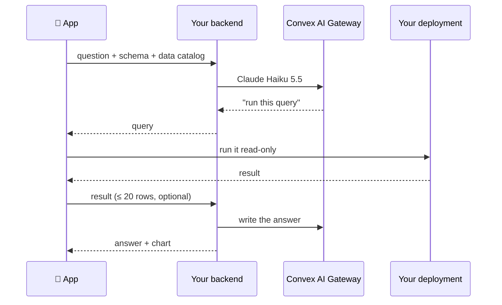

# Convex Go

An unofficial iOS dashboard for [Convex](https://convex.dev). Check your projects and deployments, browse data, run read-only queries, ask questions in plain English, and get alerts when something breaks.

> Not affiliated with Convex. Some features use undocumented endpoints (see [Caveats](#caveats)).

## How it works

There are two pieces: **the app**, and an **optional backend** that you deploy to your own Convex account. There's no shared server, so your data stays with you.



- **Without the backend**, the app talks straight to Convex with your access token. That already includes Live Logs: recent calls, errors and `console.log` output as they happen, while the screen is open.
- **With the backend**, you also get saved stats, alerts and Ask AI. It watches your deployments (see [How monitoring works](#how-monitoring-works)), and it's the only piece that talks to the AI Gateway.

## Features

| Feature | Needs |
|---|---|
| Projects, deployments, usage, limits, env vars, pause/unpause | Token |
| Metrics charts, Insights, data browser, Run Query, schedules | Token |
| Home Screen and Lock Screen widgets | Token |
| Live Logs: calls, errors and console output as they happen | Token |
| Function stats: calls and errors per function, charts | Backend (any Convex plan) |
| Instant errors: error messages, latency, saved logs | Backend + Convex Pro on the monitored app |
| Alerts: error rate, scheduler lag | Backend (any Convex plan) |
| Alerts: new error, log match, deploys | Backend + Convex Pro on the monitored app |
| Ask AI | Backend on a paid Convex plan |

Safety: Face ID lock, read-only queries, and a confirmation before any write.

## Install

### What you need

- A Mac with **Xcode 16 or newer**
- **XcodeGen**: `brew install xcodegen`
- An **Apple ID** signed in to Xcode (a free account works for running on your own iPhone)
- A **Convex account**. For the optional backend, also **Node.js 18+**

### 1. Run the app (about 5 minutes)

**Step 1: download the code**

```bash
git clone https://github.com/Jdanielcode1/convex-go.git
cd convex-go
```

**Step 2: add your signing details**

```bash
cp Config/Local.xcconfig.example Config/Local.xcconfig
```

Open `Config/Local.xcconfig` and set two values:
- `DEVELOPMENT_TEAM`: your Apple team ID. In Xcode, go to **Settings → Accounts**, select your account and look at the **Team** column. On a paid account, it's also under **developer.apple.com → Membership**.
- `BUNDLE_ID_PREFIX`: anything unique to you, like `com.yourname`.

This file is gitignored, so your details never get committed.

**Step 3: generate the Xcode project and open it**

```bash
xcodegen generate
open ConvexDashboard.xcodeproj
```

**Step 4: run it.** Pick the **ConvexDashboard** scheme and your iPhone or a simulator, then press **Run** (⌘R).

**Step 5: sign in with a Convex token.** In the Convex dashboard, go to **Team Settings → Access Tokens → Create**, then paste the token into the app. That's it.

> **Tip:** Create the token from a dedicated team member, such as a service account. The token can do whatever its owner's role allows, and dev deployments belong to whoever owns it.

### 2. Add the monitoring backend (optional, about 5 minutes)

This adds function stats, alerts, saved errors and logs, and Ask AI. It's a separate Convex project in **your** account. Your apps' code doesn't change.

```bash
cd backend
npm install
npx convex dev --once      # log in, then choose "create a new project" (e.g. "convex-pulse")
npx convex deploy          # deploy to that project's production deployment; it prints the URL
npx convex env set APP_KEY "$(openssl rand -hex 32)" --prod
npx convex env get APP_KEY --prod   # copy this value
```

Then in the app:
1. Go to **Settings → Monitoring Backend**. Paste the production URL (`https://<name>.convex.cloud`) and the `APP_KEY`, then tap **Connect**.
2. Open any deployment you want to watch and turn on **Enable Monitoring**. It works on any Convex plan. On Convex Pro, errors arrive instantly (see [How monitoring works](#how-monitoring-works)).
3. Go through the [precautions checklist](#precautions-checklist) below. It takes about 2 minutes.

Ask AI also needs the backend's team to be on a paid Convex plan, because it uses the AI Gateway.


## How monitoring works

There's one switch: **Enable Monitoring** on a deployment. The app picks the best method that deployment allows.

| | **Instant** (Convex Pro) | **Every 5 minutes** (any plan) |
|---|---|---|
| How | Convex sends every call, error and log line to your backend through a [log stream](https://docs.convex.dev/production/integrations/log-streams/) | Your backend asks Convex for each function's call and error counts every 5 minutes |
| Errors show up | Within seconds | Within about 5 minutes |
| You get | Calls, errors, latency, error messages, saved logs, every alert type | Calls and errors per function, error-rate and scheduler-lag alerts |
| Backend usage | Grows with your app's traffic | Small and flat, however busy your app is |

When you turn it on, the app:
1. Sets up the 5-minute checks. This always works, and it's the fallback.
2. Tries to add the log stream. If the deployment isn't on Convex Pro, Convex refuses it, and monitoring stays on the 5-minute checks. Nothing else to do.

On a deployment using the checks, **Turn On Instant Errors** tries the log stream again (for example after upgrading to Pro). On a busy deployment, **Turn Off Instant Errors** goes back to the checks to save backend usage. Either way, **Live Logs** (deployment → Health) shows recent calls as they happen, straight from Convex, with no backend at all.

### What it costs

Monitoring runs on **your backend's** Convex account, so it uses that account's plan. These are rough numbers per monitored deployment per month, measured on real backends:

| | **Every 5 minutes** | **Instant** |
|---|---|---|
| Function calls | ~35K/month **in total**, however many deployments | ~65K/month **each** when quiet, more when busy |
| Database bandwidth | ~0.4–0.6 GB/month each | ~0.2 GB/month each when quiet, more with many errors and logs |
| Grows with your app's traffic? | No (at most 25 functions tracked per deployment, the rest grouped) | Yes: every error and log line is saved, up to 20K errors and 100K log lines a day |

| Backend plan | Rough fit |
|---|---|
| Free (about 1M calls, 1 GB database bandwidth a month) | 1–2 deployments. Database bandwidth runs out before calls do |
| Pro (about 25M calls, 50 GB a month) | Dozens of deployments, busy ones included |

Check [convex.dev/pricing](https://www.convex.dev/pricing) for current plan limits, and **Settings → Monitoring Backend → Backend Usage** in the app for what your backend actually uses.

**You can change all of this:**
- **Turn off instant errors** on a deployment with lots of errors or logs. It goes back to the 5-minute checks, which cost the same however busy the app is.
- **Turn off monitoring** on deployments you don't need, such as old dev deployments.
- **Store less:** lower `MAX_LOG_LINES_PER_DAY`, `MAX_ERRORS_PER_DAY` or `LOG_RETENTION_HOURS` (see the [precautions checklist](#precautions-checklist)).
- **Set a usage limit** on the backend so it can never go past a budget (precaution 2).

### Instant (log stream)



1. The app creates a webhook log stream on your deployment, pointed at `https://<backend>.convex.site/logs/<deployment>`. The backend saves that stream's signing secret and checks every batch with HMAC-SHA256. It rejects batches that are more than 10 minutes old.
2. **Raw function calls are never stored.** Each batch is folded into counters: per function per minute, hour and day, plus deployment-wide totals per minute and hour. A busy app adds rows per *function per minute*, not per call.
3. **Logs and errors are stored as text**, up to a daily quota per deployment. Past the quota, they still count in the stats and still trigger alerts. Only the text is dropped until midnight UTC.
4. **The app's queries read only those counters**, and every read has a cap. The Overview reads about 24 rows per deployment, whatever your traffic.
5. **An hourly cleanup job** deletes data past its retention period, in batches.

Convex allows one webhook stream per deployment. If yours already sends logs somewhere else (Axiom, Datadog…), monitoring uses the 5-minute checks. Don't enable monitoring on the backend's own deployment, or it would ingest its own logs.

### Every 5 minutes (checks)

1. The app gives your backend its access token (stored in the backend's `secrets` table, and deleted when you turn monitoring off on the last deployment).
2. Every 5 minutes, one backend job reads each deployment's last minutes of call counts, failure rates and scheduler lag. These are the same numbers as the Health charts in the Convex dashboard. It saves them in the same counters as above, so all the screens work the same way.
3. Each minute is counted exactly once. The backend keeps track of the last minute it saved, and after a gap it catches up on up to the last 55 minutes, which is as far back as Convex keeps them.
4. Deployments with a working log stream are skipped, so nothing is counted twice.

### Built-in limits

| Limit | Default | Why |
|---|---|---|
| Log lines stored per deployment per day | 100,000 (`MAX_LOG_LINES_PER_DAY`) | Stops a chatty app from filling your database |
| Errors stored per deployment per day | 20,000 (`MAX_ERRORS_PER_DAY`) | Same, for an app stuck in an error loop |
| Distinct functions per batch | 250, the rest go under "(other functions)" | Stops runaway stat rows from dynamic names |
| HTTP action paths | IDs in URLs become `:id` (`GET /users/:id`) | One row per route, not one per request |
| Log / error message length | 2,000 / 4,000 characters | Bounds document size |

## Alerts & notifications

Alerts need the monitoring backend and monitoring turned on for the deployments you want to watch. **Error rate** and **scheduler lag** work on any plan and are checked every 5 minutes. **New error**, **log match** and **deploy** need instant errors (Convex Pro), because they read the error messages and logs as they arrive.

**What can alert you**

| Rule | Fires when |
|---|---|
| **New error** | An error appears for the first time. Similar errors are grouped, so IDs and numbers in the message don't count as new. |
| **Error rate** | More than X% of calls fail over the last N minutes (with a minimum number of calls) |
| **Scheduler lag** | Scheduled functions are running behind by more than N seconds |
| **Deploy** | Someone pushes new code. Production only by default, since `npx convex dev` pushes on every save. |
| **Log match** | A log line matches a level, some text, or a function |

On the **Alerts** tab, tap **Add Recommended Rules** to start with new errors, error rate above 5%, and production deploys. You can then edit any rule, or limit it to one deployment. Each rule has a cooldown, and it fires at most 3 times per batch of logs, so a burst of errors doesn't flood your phone.

**How notifications reach your phone**

By default you get **local notifications**, with no Apple push setup:
- While the app is open, it checks for new alerts every 30 seconds.
- In the background, it uses iOS **Background App Refresh**. iOS decides when that runs, usually every 15 minutes or more, and less often in Low Power Mode or if you rarely open the app. Keep Background App Refresh on for the app in iOS Settings.
- Tapping a notification opens that alert in the Alerts tab. Every alert is also kept in the Alerts tab history for 30 days.
- Allow notifications under **Settings → Notifications** in the app.

Local notifications can arrive late. For instant delivery, set up real push notifications:

<details>
<summary>Optional: real push notifications (APNs)</summary>

Requires a paid Apple developer account.

1. In your Apple developer account, create an APNs key (.p8) and note its Key ID.
2. Set these on the backend:
   ```bash
   npx convex env set APNS_KEY_P8 "$(base64 -i AuthKey_XXXX.p8)" --prod
   npx convex env set APNS_KEY_ID XXXX --prod
   npx convex env set APNS_TEAM_ID <your team ID> --prod
   npx convex env set APNS_BUNDLE_ID <your BUNDLE_ID_PREFIX>.convexdashboard --prod
   ```
3. Build the app with the `SUPPORTS_REMOTE_PUSH` compilation flag and an `aps-environment` entitlement.

Never commit the `.p8` file. The `.gitignore` already blocks it. Alerts that were pushed aren't sent again as local notifications.

</details>

## Precautions checklist

Do these once after deploying the backend.

**1. Use a strong `APP_KEY`.**
- `APP_KEY` is the only thing protecting your stats, logs, alert rules and AI history. Anyone who has it can read them.
- Use the `openssl rand -hex 32` command above (64 characters). Never use a short or reused password.
- To rotate it, run `npx convex env set APP_KEY "$(openssl rand -hex 32)" --prod`, then reconnect in the app. This takes effect immediately and doesn't need a redeploy.

**2. Set a usage limit on the backend itself.** With instant errors, every batch of events your apps send runs functions on the backend, so a traffic spike on a monitored app becomes usage on the backend. The 5-minute checks cost the same however busy your apps are.
- In the app, go to **Settings → Monitoring Backend → Backend Usage → Usage Limits**. Add a *warning* limit on Function Calls, and optionally a *disable* limit as a hard stop.
- If a disable limit trips, your monitored apps keep running, but monitoring stops. Convex marks each log stream as failed when the backend stops answering. After you re-enable the backend, tap **Repair** on each monitored deployment, or **Use 5-Minute Checks Instead**.

**3. Choose how long to keep data.** These are optional environment variables, set with `npx convex env set NAME value --prod`. Changes apply within the hour, with no redeploy.

| Variable | Default | Range |
|---|---|---|
| `LOG_RETENTION_HOURS` | 24 | 1–168 |
| `ERROR_RETENTION_DAYS` | 7 | 1–30 |
| `STATS_RETENTION_DAYS` | 30 | 8–90 (also covers alert history, audit events and AI chats) |
| `MAX_LOG_LINES_PER_DAY` / `MAX_ERRORS_PER_DAY` | 100,000 / 20,000 | |

Keeping less data is cheaper and exposes less if your key leaks. Logs often contain user data, so keep them only as long as you need them.

**4. Keep secrets out of logs.** With instant errors, the backend stores whatever your apps pass to `console.log`. Don't log tokens, passwords or personal data in the apps you monitor.

**5. Know that the backend holds your access token.** The 5-minute checks need the app's access token on the backend, so treat the backend's dashboard access like the token itself. It's deleted when you turn off monitoring on the last deployment. If you revoke the token, monitoring shows **Reconnect**.

**6. Upgrading from an older backend?** Run this once after `npx convex deploy`, so existing stats appear in the new charts:

```bash
npx convex run rollups:rebuild --prod
```

It runs in the background and is safe to run again.

**7. Check for write conflicts if you have heavy traffic.** Batches for the same deployment update the same counter rows. Convex retries conflicting writes automatically, but you can confirm with `npx convex insights --prod`. In the app, the same information is under deployment → Health → Insights.

## Ask AI

Ask a question like *"how many users signed up this week?"* and get back a number, a chart or a list.



**Why it's split this way**
- **The model runs in your backend** through the [Convex AI Gateway](https://docs.convex.dev/ai-gateway/overview). You don't need an OpenAI or Anthropic key. Convex holds the credentials and bills your Convex account.
  - The backend gets a short-lived token with `getServiceToken("ai-gateway")` and calls the gateway's Anthropic-style `/v1/messages` endpoint (`backend/convex/lib/gateway.ts`).
  - The gateway needs `convex` 1.45+, a paid plan, and a Convex Cloud deployment. It's in beta.
- **The queries run on your phone**, because only the phone holds your access token. The backend never reads your app's data.

**The data catalog:** The first time you use Ask AI on a deployment, the app samples recent documents from each table. The model then writes short descriptions of each table and field. Those descriptions are sent with every question, so the model understands your data. The catalog rebuilds after you deploy.

**Guardrails (enforced in code)**
- Queries can only read. The sandbox has no insert, patch or delete.
- Each query has a read budget: 10,000 documents on production, 25,000 elsewhere. Over budget, the model has to try a cheaper query.
- **Settings → Run AI queries:** run automatically, ask on production, always ask, or skip.
- **Settings → AI can see results:** turn it off and the model sees only row counts and field names.
- Chats are kept in your backend for 30 days. Reopening a chat never reruns its queries.

**Cost:** under $0.01 per answer with the default model, plus a few cents once per deployment for the catalog. (We measured about $0.02 per answer on Haiku 4.5. Haiku 5.5 costs a tenth as much per token.) Set a usage limit on **AI Gateway Cost** on the backend if you want a hard cap.

### Changing the AI model

The default is **Claude Haiku 5.5**: fast, cheap, and good at writing Convex queries. You can switch with one command, with no code change or redeploy:

```bash
npx convex env set AI_MODEL anthropic/claude-sonnet-5 --prod
```

- Use any model ID from the [AI Gateway model list](https://docs.convex.dev/ai-gateway/models).
- **Works out of the box:** Claude Haiku 5.5 or 4.5, Sonnet 5 or 4.x, and Opus 4.x. For tricky questions, Sonnet 5 is smarter but costs more.
- **Need a small code change:** Claude Sonnet 5.5, Opus 5.5 and Fable 5.1. They don't allow the forced tool calls and thinking-off setting the chat uses (see `backend/convex/lib/gateway.ts`). Other providers' models may also need changes.
- To go back to the default, run `npx convex env remove AI_MODEL --prod`.

## Project layout

```
ConvexDashboard/   SwiftUI app (Views, ViewModels, Models, Services, Theme)
ConvexWidgets/     WidgetKit extension
backend/           Convex backend: monitoring (log ingest + 5-minute checks), stats, alerts, Ask AI
Config/            Signing settings (your values go in Local.xcconfig)
design/            App icon source (swift design/make_icon.swift <output.png>)
project.yml        XcodeGen spec — the .xcodeproj is generated from it
```

Backend commands (in `backend/`): `npm test`, `npm run typecheck`, `npx convex dev`.

Working on the backend with an AI coding tool? Read `backend/convex/_generated/ai/guidelines.md` first (Convex's official rules, refreshed with `npx convex ai-files update`).

## Caveats

- **Undocumented endpoints:** the metrics charts, Insights, the data browser, Live Logs and the 5-minute checks use the same private endpoints as the official Convex dashboard and CLI, so they could break.
- **Live Logs shows recent calls only:** Convex keeps about the last 1,000 calls in memory. For history, turn on instant errors.
- **No deploys from the phone:** pushing code needs the Convex CLI.
- **Background alerts are best effort:** iOS decides when background refresh runs.

## Security

Found a vulnerability? Please report it privately through the repo's **Security → Report a vulnerability** tab, not in a public issue.

## License

[MIT](LICENSE). Bundled fonts (Kanit, IBM Plex Mono) use the SIL Open Font License. "Convex" is a trademark of its owner, and this is an independent project.
